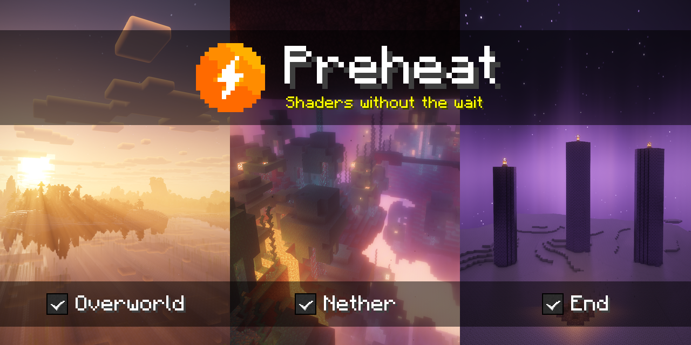
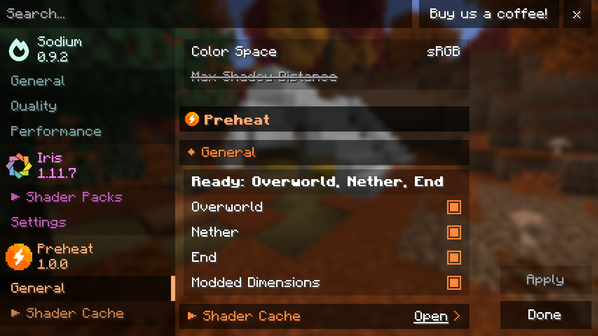

  
  
  
  
  

Going through a portal with shaders can freeze your game while Iris prepares the next dimension, and coming back can mean waiting again. Preheat prepares the Nether and the End while the game loads and keeps each dimension's shaders ready for your next visit. It also saves the shaders, so later launches have less to prepare.

This is an unofficial, community mod. It is not affiliated with, authorised by, or endorsed by Iris, Sodium or Mojang.

## Requirements

Java 25 and Minecraft 26.2 or 26.3 on Fabric or NeoForge, with [Iris](https://modrinth.com/mod/iris) 1.11.4 or newer and [Sodium](https://modrinth.com/mod/sodium). [Compatibility](docs/compatibility.md) lists the Iris versions each feature is tested against.

## Install

1. Install Iris and Sodium for your Minecraft version.
2. Download Preheat from [Modrinth](https://modrinth.com/mod/preheat) or the [latest release](https://github.com/lewisgibson/preheat/releases/latest): `preheat-<version>+mc26.3.jar` for Minecraft 26.3 or `preheat-<version>+mc26.2.jar` for 26.2. Each works on Fabric and NeoForge.
3. Put the jar in your game's `mods` folder.

The defaults work as they are. To upgrade, replace the jar; your settings and saved shaders are kept.

## Choosing dimensions

Open **Options > Video Settings > Preheat** and tick the dimensions to keep ready. **Shader Cache** on the same page opens Preheat's own screen, which shows which dimensions are ready and how much is saved, and lets you open, delete or move the saved shaders. The screen also opens from Mod Menu or NeoForge's mod list.

## Settings

Some you may want to change:

| Setting | Default | What it does |
| --- | --- | --- |
| Each dimension's tick | On | Keeps that dimension's shaders ready after it is prepared |
| **Modded Dimensions** | On | Whether dimensions added by mods are kept ready after your first visit |
| `prepareAtStartup` | The Overworld, Nether and End | Which dimensions are prepared while the game loads |
| Cache folder | `preheat/shader-cache` in your game folder | Where the saved shaders go |

[Configuration](docs/configuration.md) explains every setting and the settings file for modpacks.

## Documentation

- [Configuration](docs/configuration.md)
- [Compatibility](docs/compatibility.md)
- [Performance](docs/performance.md)
- [The shader cache](docs/shader-cache.md)
- [Troubleshooting](docs/troubleshooting.md)
- [FAQ](docs/faq.md)
- [Deployment](docs/deployment.md)
- [Architecture](docs/architecture.md)
- [Building](docs/building.md)
- [Testing](docs/testing.md)
- [Releasing](docs/releasing.md)
- [Roadmap](docs/roadmap.md)

## Contributing

Issues and pull requests are welcome. [CONTRIBUTING.md](CONTRIBUTING.md) explains how to build and test Preheat, and [architecture](docs/architecture.md) describes how it works.

## Acknowledgements

- [Iris](https://github.com/IrisShaders/Iris) and [Sodium](https://github.com/CaffeineMC/sodium) do the rendering. Preheat changes when shaders are prepared and how they are reused, not how they look.
- The screenshots use [Complementary Reimagined](https://modrinth.com/shader/complementary-reimagined) by EminGT.

## License

[LGPL-3.0-only](LICENSE), the same licence as Iris. The jars contain only Preheat's own code; see [THIRD-PARTY-NOTICES.txt](THIRD-PARTY-NOTICES.txt).
