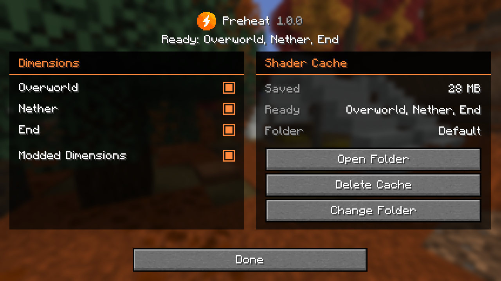

# Configuration

Preheat starts with the vanilla dimensions enabled and its cache in your game folder. You can change the dimension settings while playing. Modpack settings are also available in `config/preheat.json`.

## Where the settings are

| Location | Contents |
| --- | --- |
| **Options > Video Settings > Preheat > General** | Current status, a tick for each dimension and **Modded Dimensions** |
| **Options > Video Settings > Preheat > Shader Cache** | Opens Preheat's own screen |
| Preheat's screen, also available through **Configure** in Mod Menu or NeoForge's mod list | Dimension ticks, ready dimensions, saved size, cache location and folder controls |
| `config/preheat.json` | Dimension settings, startup and exclusion lists, cache location and a troubleshooting switch |

Dimension changes are saved when you make them and take effect from the next dimension change.



## The status line

The status line uses the first applicable state in this table:

| Text | Meaning |
| --- | --- |
| This version of Iris isn't supported yet, so Preheat is off. Check for an update. | No supported feature is available. The log explains why. |
| Preheat is switched off in its settings file. | `enabled` is `false`. |
| Preheat is off because no dimension is ticked. | Every dimension and **Modded Dimensions** are unticked. |
| Choose a shader pack in Iris to use Preheat. | Iris has no active shader pack. |
| Shaders are prepared when the game starts. | No dimensions are ready yet. |
| Ready: Overworld, Nether, End | The listed dimensions' shaders are prepared and retained. |

## Dimensions

| Setting | Default | Effect |
| --- | --- | --- |
| Each dimension's tick | On for the vanilla dimensions | Keeps that dimension's shaders ready after preparation. It is also prepared during loading if selected by `prepareAtStartup`. |
| **Modded Dimensions** | On | Sets the initial tick for newly discovered dimensions. |

Unticking a dimension stops Preheat retaining its shaders. Iris prepares them on visits as it would without Preheat.

A modded dimension needs a separate tick only if your shader pack has shaders of its own for it. Other dimensions share the Overworld's or End's shaders and follow that dimension's tick. Newly discovered dimensions appear on Preheat's screen immediately and in Video Settings after the next restart.

Untick every dimension and **Modded Dimensions** to switch Preheat off.

## The shader cache

| Control | Effect |
| --- | --- |
| **Open Folder** | Opens the cache folder in your file manager. |
| **Delete Cache** | Asks for confirmation, then deletes the saved shaders. They are prepared and saved again when needed. This also clears a paused cache. |
| **Change Folder** | Opens the folder settings. Enter a full path or use **Browse...**, then choose **Use This Folder**. **Use the Default Folder** restores the standard location. |
| **Move Them** | Moves existing saved shaders when changing folders. |
| **Start Fresh** | Uses the new folder and leaves existing saved shaders in the old one. |
| **Cancel** | Cancels the proposed folder change. |

If **Browse...** is unavailable, type the full path.

The default location is `<game folder>/preheat/shader-cache`. A chosen folder gets a `preheat-shader-cache` subfolder managed by Preheat. If it cannot be used, Preheat falls back to the default and shows the reason.

The cache has a fixed 4 GB maintenance limit. If it exceeds that limit, the saved shaders used longest ago are deleted first. There is no size setting. See [the shader cache](shader-cache.md#where-it-is) for folder handling.

## config/preheat.json

Preheat creates this file when it saves settings, including newly discovered dimensions. A missing or unreadable file uses the defaults. Close the game before editing it by hand.

This example keeps the default settings and includes a discovered modded dimension:

```json
{
  "enabled": true,
  "dimensions": {
    "minecraft:overworld": true,
    "minecraft:the_end": true,
    "minecraft:the_nether": true,
    "aether:the_aether": true
  },
  "cacheFolder": "",
  "moddedDimensions": true,
  "prepareAtStartup": ["minecraft:overworld", "minecraft:the_nether", "minecraft:the_end"],
  "neverKeep": []
}
```

| Key | Type | Default | Effect |
| --- | --- | --- | --- |
| `enabled` | Boolean | `true` | File-only troubleshooting switch. `false` disables Preheat. |
| `dimensions` | Dimension ids mapped to Booleans | Vanilla three set to `true` | Individual dimension ticks. |
| `cacheFolder` | String | `""` | Custom parent folder, or empty for the default. Use **Change Folder** to move existing saved shaders. |
| `moddedDimensions` | Boolean | `true` | Initial setting for newly discovered dimensions, matching **Modded Dimensions**. |
| `prepareAtStartup` | List of patterns | Vanilla three | Selects enabled, known dimensions to prepare during loading. |
| `neverKeep` | List of patterns | Empty | Prevents matching dimensions from being retained or prepared ahead. Takes precedence over ticks and `prepareAtStartup`. |

### Patterns

In `prepareAtStartup` and `neverKeep`, `*` matches any run of characters. Matching ignores case and surrounding spaces in the pattern.

| Pattern             | Matches                                 | Does not match           |
| ------------------- | --------------------------------------- | ------------------------ |
| `aether:the_aether` | `aether:the_aether`                     | `aether:the_aether_2`    |
| `aether:*`          | Every dimension in the Aether namespace | `minecraft:the_end`      |
| `backrooms:level*`  | `backrooms:level0`, `backrooms:level37` | `backrooms:attic`        |
| `*:mining`          | `allthemodium:mining`                   | `allthemodium:the_other` |
| `*`                 | Every dimension                         |                          |

Startup patterns select dimensions already listed in `dimensions`. For a modpack that must prepare a dimension before anyone has visited it, include its id there with `true` as well as selecting it in `prepareAtStartup`. The shader pack must also provide separate shaders for it.

### Examples

To prepare the Twilight Forest and the Aether at startup, include these settings in the file:

```json
{
  "dimensions": {
    "minecraft:overworld": true,
    "minecraft:the_nether": true,
    "minecraft:the_end": true,
    "twilightforest:twilight_forest": true,
    "aether:the_aether": true
  },
  "prepareAtStartup": [
    "minecraft:overworld",
    "minecraft:the_nether",
    "minecraft:the_end",
    "twilightforest:twilight_forest",
    "aether:the_aether"
  ]
}
```

To avoid keeping dimensions made per player or per item, use the relevant namespaces:

```json
{
  "neverKeep": ["rftoolsdim:*", "mystcraft_ageless:*", "multiworld:*"]
}
```

These mod names illustrate the format. See [compatibility](compatibility.md#modded-dimensions) for testing limits.

If you never visit the End, remove it from startup preparation:

```json
{
  "prepareAtStartup": ["minecraft:overworld", "minecraft:the_nether"]
}
```

Also untick **End** so its shaders are not retained after a visit.

## Java options for troubleshooting

These go in your launcher's JVM arguments. Normal play needs none of them.

| Option | Effect |
| --- | --- |
| `-Dpreheat.verifyPatchCache=true` | Makes Iris repeat its saved shader preparation and compare the results. Logs `PREHEAT Patch cache check: ...` and any differences. This slows loading. |
| `-Dpreheat.debugCacheMisses=<folder>` | Writes the details used to identify each missing saved shader into `<folder>`, so launches can be compared. |
| `-Dpreheat.trustUnknownIris=true` | Bypasses the behaviour check for retaining dimensions on an unrecognised Iris build. Use only when investigating compatibility; that behaviour has not been verified. |
